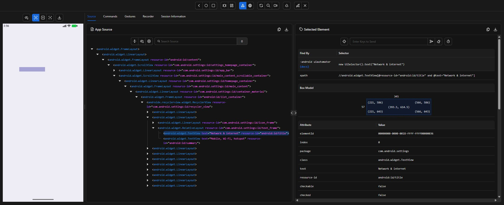
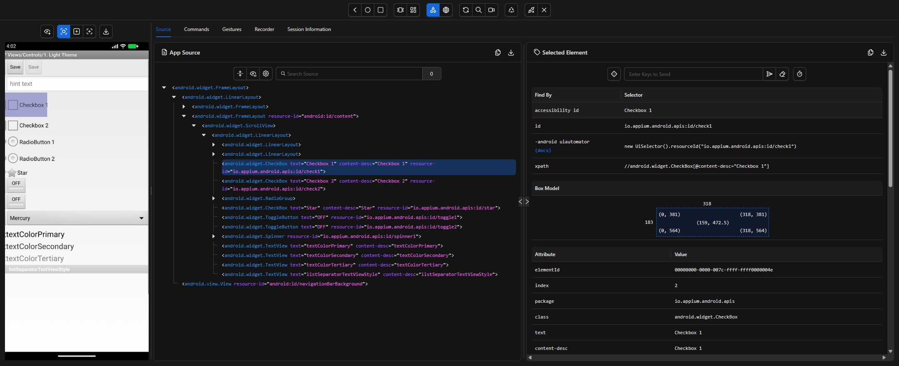

# Appium Inspector notes

Start `npm.cmd run server`, then open `http://127.0.0.1:4723/inspector`. Use host `127.0.0.1`, port `4723`, path `/`.

In Edit Raw JSON, use these Settings capabilities:

```json
{
  "platformName": "Android",
  "appium:automationName": "UiAutomator2",
  "appium:deviceName": "Android emulator",
  "appium:udid": "emulator-5554",
  "appium:appPackage": "com.android.settings",
  "appium:appActivity": "com.android.settings.Settings",
  "appium:noReset": true,
  "appium:forceAppLaunch": true
}
```

For API Demos, replace the package and activity with `io.appium.android.apis` and `io.appium.android.apis.ApiDemos`. Add `appium:app` with the absolute path to `apps/ApiDemos-debug.apk` if it is not installed yet. End each Inspector session before starting Java tests.

Select an element in the device screenshot or source tree. Inspector shows its `resource-id`, `content-desc` and suggested XPath. Use Search for Element to check a locator matches the expected element.

| Screen | Strategy | Locator |
| --- | --- | --- |
| Settings | XPath | `//*[@text='Network & internet']` |
| API Demos home | Accessibility ID | `Views` |
| Controls / 1. Light Theme | ID | `io.appium.android.apis:id/edit` |
| Controls / 1. Light Theme | ID | `io.appium.android.apis:id/check1` |
| Seek Bar | ID | `io.appium.android.apis:id/seek` |
| Seek Bar result | ID | `io.appium.android.apis:id/progress` |
| Drag and Drop | ID | `io.appium.android.apis:id/drag_dot_1` |
| Drag and Drop target | ID | `io.appium.android.apis:id/drag_dot_2` |
| Drag and Drop result | ID | `io.appium.android.apis:id/drag_result_text` |
| Views list | Accessibility ID | `WebView` |
| Chrome page | HTML ID | `name`, `submit`, `result` |

Resource IDs are preferred for controls. Accessibility IDs work well for API Demos menu rows. The Settings XPath uses a visible label because Settings layouts and resource IDs vary between Android versions.

## Inspector captures

These captures are from Inspector connected to the actual emulator used for the tests.



